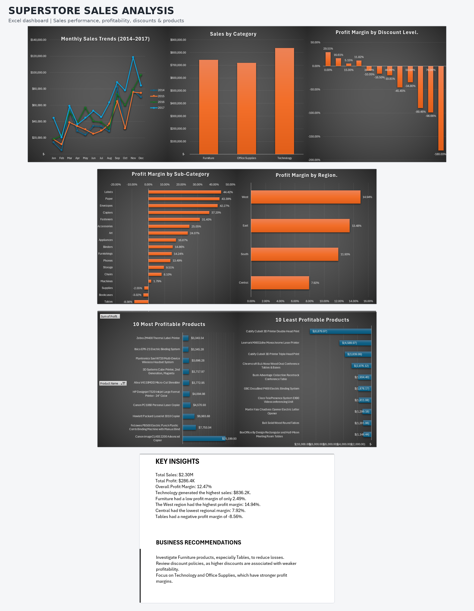

# Superstore Sales Analysis

## Project Overview
A retail sales analysis and dashboard project. The goal was to explore sales performance, profitability, discount patterns, and product performance through data analysis and an interactive-style dashboard.

## Dataset

- **Source:** [Kaggle – Superstore Dataset Final](https://www.kaggle.com/datasets/vivek468/superstore-dataset-final)
- **File used:** Sample - Superstore.csv
- **Records:** 9,994 rows
- **Columns:** 21

## Dashboard Preview

## Tools Used
- Microsoft Excel
- PivotTables
- PivotCharts
- Excel formulas
- Data visualization

## Methodology

- Used the original Sample Superstore dataset.
- Analyzed sales and profitability using Excel PivotTables and PivotCharts.
- Created calculated fields and formulas to evaluate profit margins.
- Built an interactive-style dashboard to present key findings.

## Dashboard
The dashboard presents key business metrics and visualizations, including:
- Total Sales
- Total Profit
- Overall Profit Margin
- Monthly Sales Trends (2014–2017)
- Sales by Category
- Profit Margin by Discount Level
- Profit Margin by Sub-Category
- Profit Margin by Region
- 10 Most Profitable Products
- 10 Least Profitable Products

## Key Findings
- Total sales reached approximately **$2.30 million**.
- Total profit was approximately **$286.4 thousand**.
- Overall profit margin was **12.47%**.
- Technology generated the highest sales at approximately **$836.2 thousand**.
- Furniture had a relatively low profit margin of **2.49%**.
- The West region had the highest profit margin at **14.94%**.
- The Central region had the lowest profit margin at **7.92%**.
- Tables had a negative profit margin of **-8.56%**.
- **Discount Impact on Tables:** Tables generated $17,725.48 in losses, with an overall profit margin of -8.56%. The 0% discount group had an 18.55% profit margin, while all discount levels from 20% to 50% were unprofitable.

## Business Recommendations
- Investigate Furniture products, especially Tables, to identify the causes of losses.
- Review discount policies, as higher discount levels were associated with weaker profitability in this dataset.
- Focus on Technology and Office Supplies, which demonstrated stronger profit margins.
- Investigate the factors contributing to the lower profitability in the Central region.
- **Review Tables Discount Strategy:** Reassess discounting practices for Tables products, especially discounts of 20% or higher, and evaluate pricing and costs to improve profitability.

## Files
- `Superstore_Sales_Analysis.xlsx` — Excel workbook containing the analysis and dashboard.

## Author
Adam Okour  
Data Science Student
